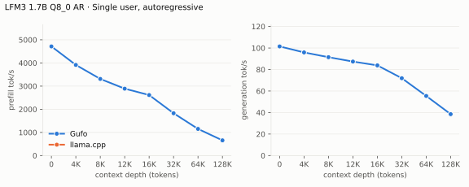
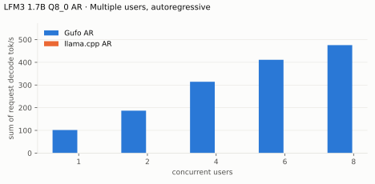
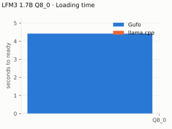
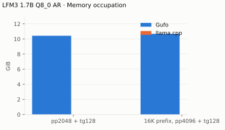

# LFM3 1.7B benchmarks

AMD Strix Halo `gfx1151`, 128 GB unified memory. Official `Q8_0` GGUF
(`b3f2ae5d`). HTTP, greedy, thinking off. Gufo `bd6b0fdd` with this extension
(November 10, 2026; CMake release build, binary SHA-256 `4e5f18c73333`,
platform profile performance). Positive gain favors Gufo. **TODO** means unmeasured: the
llama.cpp reference (b12205 or newer, the first release with LFM3) has not
been run yet.
[Quality and measurement details](QUALITY.md) · [Benchmark configuration](artifacts/bench.json)

## Single user, autoregressive

pp2048 / tg128; depth is the cached prefix in tokens.

<!-- bench:single-ar -->
| LFM3 1.7B Q8_0 AR Depth (tokens) | Gufo pp (tok/s) | llama.cpp pp (tok/s) | Gain | Gufo tg (tok/s) | llama.cpp tg (tok/s) | Gain |
| ---: | ---: | ---: | ---: | ---: | ---: | ---: |
| 0 | 8789.59 | TODO | TODO | 109.30 | TODO | TODO |
| 4,096 | 8163.31 | TODO | TODO | 106.24 | TODO | TODO |
| 8,192 | 7748.16 | TODO | TODO | 103.66 | TODO | TODO |
| 12,288 | 7165.30 | TODO | TODO | 100.95 | TODO | TODO |
| 16,384 | 6995.11 | TODO | TODO | 98.79 | TODO | TODO |
| 32,768 | 6036.79 | TODO | TODO | 90.42 | TODO | TODO |
| 65,536 | 4651.75 | TODO | TODO | 77.21 | TODO | TODO |
| 131,072 | 3334.60 | TODO | TODO | 60.33 | TODO | TODO |
<!-- /bench -->

## Multiple users, autoregressive

Same pp2048 prose prompt as single-user d0, tg128, context 4096 per user.
Every session is prefilled before timed decoding; throughput sums individual
request decode rates.

<!-- bench:multi-ar -->
| LFM3 1.7B Q8_0 AR Users | Gufo AR (tok/s) | llama.cpp AR (tok/s) | Gain |
| ---: | ---: | ---: | ---: |
| 1 | 109.44 | TODO | TODO |
| 2 | 198.55 | TODO | TODO |
| 4 | 350.73 | TODO | TODO |
| 6 | 471.94 | TODO | TODO |
| 8 | 558.16 | TODO | TODO |
<!-- /bench -->

## Loading time

C1, context capacity 262144, AR. Cold model file (evicted from the page
cache and verified non-resident) to HTTP readiness.

<!-- bench:loading -->
| LFM3 1.7B Q8_0 Target | Gufo ready (s) | llama.cpp ready (s) | Gain |
| --- | ---: | ---: | ---: |
| Q8_0 | 1.02 ± 0.09 | TODO | TODO |
<!-- /bench -->

## Memory occupation

C1, context capacity 133121, AR. Peak device memory in use reported by HIP.

<!-- bench:memory -->
| LFM3 1.7B Q8_0 AR Workload | Gufo GiB | llama.cpp GiB | Gain |
| --- | ---: | ---: | ---: |
| pp2048 + tg128 | 10.43 | TODO | TODO |
| 16K prefix, pp4096 + tg128 | 10.68 | TODO | TODO |
<!-- /bench -->

