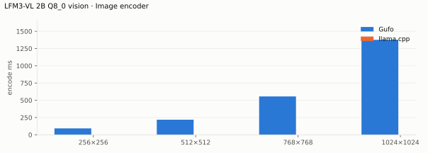

# LFM3-VL 2B benchmarks

AMD Strix Halo `gfx1151`, 128 GB unified memory. Official `Q8_0` backbone and
BF16 projector (`b36554cf`). HTTP, greedy, thinking off. Gufo `12f8d8ab` with
this extension (November 8, 2026). Positive gain favors Gufo. **TODO** means
unmeasured: the llama.cpp reference (b12205 or newer) has not been run yet.
[Quality](QUALITY.md) · [Benchmark configuration](artifacts/bench.json)

## Image encoder

Prompt time of a request carrying one gradient PNG and a one-line question,
one output token, prompt cache off: image decoding and resizing, the vision
tower, the projector and the prefill of the image and text tokens. One warmup,
then the mean of three requests per size.

<!-- bench:image-encoder -->
| LFM3-VL 2B Q8_0 vision RGB image | Merged tokens | Gufo ms | llama.cpp ms | Gain |
| --- | ---: | ---: | ---: | ---: |
| 256×256 | 64 | 92.4 ± 0.3 | TODO | TODO |
| 512×512 | 256 | 218.4 ± 0.3 | TODO | TODO |
| 768×768 | 576 | 556.2 ± 1.9 | TODO | TODO |
| 1024×1024 | 1024 | 1376.0 ± 8.0 | TODO | TODO |
<!-- /bench -->

Text-only speed of this backbone, throughput beside other sessions and
images larger than 1024×1024 are not measured.
